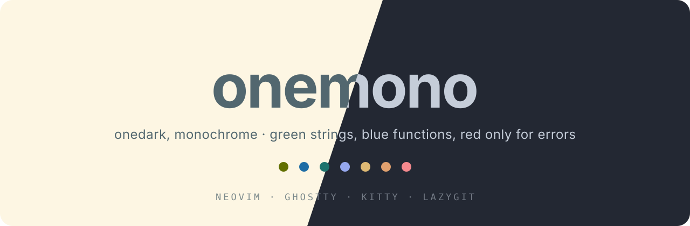
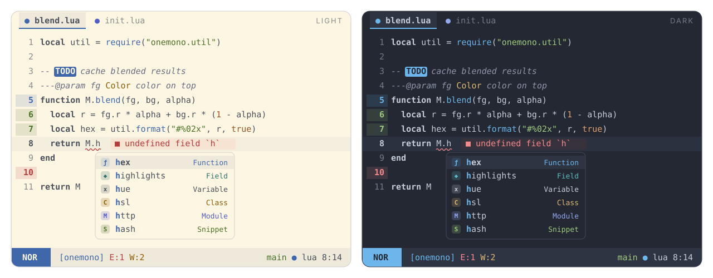

<p align="center">
  
</p>

<p align="center">
  <b>Onedark, quieted down.</b><br>
  Onedark dark and Solarized light: four hues for code, and red only for errors and deletions.
</p>

<p align="center">
  
  
  
</p>

---

<p align="center">
  
</p>

## Dedication

Madu is named in honor of my wife. This is my perfect theme, just as she is
perfect for me and our family. Made with love, dedicated to her.

## Philosophy

Onedark (and its variant [edge](https://github.com/sainnhe/edge)) is a
beautiful palette, but it paints keywords purple, variables red and
constants orange. Red code that is not an error is noise, and after a while
the rainbow stops telling you anything. **Madu** keeps the Onedark
backgrounds and hues, and cuts the syntax down to what earns a color:

- **Code is mostly one color.** Keywords, variables, properties, modules and
  operators all use the same foreground. Only four things get a hue, the same
  colors their LSP kinds use in the completion menu:
  | Token | Color |
  | --- | --- |
  | strings | **green** |
  | functions and methods | **blue** |
  | types, classes, constructors | **yellow** |
  | constants, numbers, booleans, `null` | **orange** |

  Everything else is told apart by shape. Keywords are bold; comments are
  italic and a step dimmer than the code (still WCAG AA), and you can change
  both. Set `mono = true` for subtle, near-neutral hues.
- **Dark Markdown uses the same four hues.** Light Markdown follows Solarized with monochrome text. Headings vary by level (blue, yellow,
  green, orange, blue, yellow); links are blue, inline code and quotes green,
  bold text and list markers orange, and italic text yellow.
- **Red means error.** It appears on diagnostics, error messages,
  `FIXME`/`BUG` markers, git deletions and the Visual mode block of the
  statusline, and nowhere in code.
  A test checks this.
- **No purple, no pink.** They are not in the palette. Where a tool needs a
  "magenta" (ANSI color 5, mini.icons purple icons) it gets a calm azure.
- **Color where it means something:**
  | Where | Colors |
  | --- | --- |
  | Git (gitsigns, diff, lazygit) | add **green** · change **blue** · delete **red** |
  | Diagnostics | error red · warn yellow · info blue · hint cyan · ok green |
  | LSP completion kinds (blink.cmp, dropbar) | one color per kind, the same everywhere and the same as in the code |
  | File icons (mini.icons) | icon colors, with red folded into orange and purple into azure |
  | Search, `TODO` / `FIXME` / `NOTE` markers | attention colors |
  | Statusline modes (`StMode*`) | normal **blue** · insert **green** · visual **red in dark / cyan in light** · replace **orange** · command **azure** · other **cyan** |
- **Easy on the eyes.** The dark variant is a blue-leaning slate (`#232833`)
  with edge's cool off-white text; the light variant is a warm, yellow-leaning paper (`#fdf6e3`)
  with Solarized blue-gray text. Selected picker matches retain Solarized light’s 4.27:1 contrast (dark: ≥ 4.5:1). Every accent passes **WCAG AA (≥ 4.5:1)** on both the
  background and the selection color (`scripts/contrast.lua`).

## Features

- Two variants, `light` and `dark`, plus `madu`, which follows
  `'background'`. Neovim 0.10+ detects the terminal background (OSC 11), so the
  theme matches your terminal automatically.
- **Extreme performance.** Highlights are compiled to stripped LuaJIT
  bytecode with integer colors. A cached load is a single `loadfile()` and runs in
  **about 4 ms**, roughly 2× faster than the built-in `habamax`. The cache is
  keyed by a hash of your config, so it never goes stale.
- Built for **Neovim 0.12**. It covers every group the default colorscheme defines,
  plus `OkMsg`, `StderrMsg`, `StdoutMsg`, `DiffTextAdd`, `PmenuMatch`, `PmenuBorder`,
  `PmenuShadow`, `ComplMatchIns`, `SnippetTabstop*`, `DiagnosticVirtualLines*`,
  `LspReferenceTarget`, treesitter captures and LSP semantic tokens.
- **Matching themes for other tools**, generated from the same palette:
  Ghostty, Kitty and Lazygit.

## Supported plugins

| Plugin | Notes |
| --- | --- |
| [blink.cmp](https://github.com/saghen/blink.cmp) | menu, docs, signature, ghost text, **colored kinds** (also `CmpItemKind*`) |
| [mini.icons](https://github.com/echasnovski/mini.icons) | real icon colors |
| [mini.pick](https://github.com/echasnovski/mini.pick) / [mini.extra](https://github.com/echasnovski/mini.extra) | |
| [mini.files](https://github.com/echasnovski/mini.files) | |
| [mini.tabline](https://github.com/echasnovski/mini.tabline) | accent underline on the current buffer, modified buffers in the git "change" blue |
| [gitsigns.nvim](https://github.com/lewis6991/gitsigns.nvim) | signs, `numhl`, `linehl`, inline, preview, staged, blame |
| [dropbar.nvim](https://github.com/Bekaboo/dropbar.nvim) | kind icons colored like the completion menu |
| [grug-far.nvim](https://github.com/MagicDuck/grug-far.nvim) | |
| [mason.nvim](https://github.com/mason-org/mason.nvim) | |
| [lazy.nvim](https://github.com/folke/lazy.nvim) | |
| [nvim-treesitter](https://github.com/nvim-treesitter/nvim-treesitter) | captures incl. `@markup.*`, `@diff.*`, `@comment.todo` … |

## Installation

[lazy.nvim](https://github.com/folke/lazy.nvim):

```lua
{
  "amonteirom96/madu.nvim",
  lazy = false,
  priority = 1000,
  opts = {},
  config = function(_, opts)
    require("madu").setup(opts)
    vim.cmd.colorscheme("madu")
  end,
}
```

No `build` step is needed: the cache is keyed by the plugin version and your
config, so an update recompiles on its own.

> [!NOTE]
> If lazy.nvim fails with `E492: Not an editor command: EssentialCompile`, your
> spec still has the `build` line from essential.nvim. Remove it (or change it
> to `":MaduCompile"`) and restart Neovim.

Native `vim.pack` (Neovim 0.12):

```lua
vim.pack.add({ "https://github.com/amonteirom96/madu.nvim" })
require("madu").setup({})
vim.cmd.colorscheme("madu")
```

### Colorschemes

| Command | Behavior |
| --- | --- |
| `:colorscheme madu` | follows `'background'` (or the `variant` option) |
| `:colorscheme madu-light` | always light |
| `:colorscheme madu-dark` | always dark |

## Configuration

Calling `setup()` is optional. These are the defaults:

```lua
require("madu").setup({
  variant = "auto",          -- "auto" (follow 'background') | "light" | "dark"
  transparent = false,       -- no background on Normal, floats and the sign column
  terminal_colors = true,    -- set g:terminal_color_0..15
  dim_inactive = false,      -- slightly different background on unfocused windows
  muted_comments = false,    -- comments even fainter, in the muted UI tone
  mono = false,              -- subtle hues: pale in dark, deep in light
  float = {
    -- solid defaults to false in light, true in dark
    -- solid = true,          -- override for both variants
  },
  styles = {                 -- any nvim_set_hl attributes (bold, italic, underline…)
    comments = { italic = true },
    keywords = { bold = true },
    functions = {},
    variables = {},
    strings = {},
    types = {},
    constants = {},
    operators = {},
  },
  integrations = {           -- set to false to skip a plugin's groups
    blink = true,
    dropbar = true,
    gitsigns = true,
    grug_far = true,
    lazy = true,
    mason = true,
    mini = true,             -- icons, pick, extra, files, tabline
    semantic_tokens = true,
    statusline = true,       -- St* groups for a custom statusline
    treesitter = true,
  },
  cache = true,              -- compile to bytecode (turn off only while hacking on the theme)

  --- Change the palette before any highlight is built.
  ---@param colors madu.Colors
  ---@param variant "light"|"dark"
  on_colors = function(colors, variant) end,

  --- Add or change highlight groups.
  ---@param hl table<string, vim.api.keyset.highlight>
  ---@param colors madu.Colors
  ---@param variant "light"|"dark"
  on_highlights = function(hl, colors, variant) end,
})
```

### Examples

**Soft monochrome with visible hues.** Keep the original color families close
in tone: pale, nearly white accents in dark mode and deep, nearly black accents
in light mode. Backgrounds and UI surfaces stay the same; code, icons, Git,
diagnostics and terminal colors use the softened palette.

```lua
require("madu").setup({
  mono = true,
})
```

`mono` defaults to `false`. Colors remain distinct rather than becoming a
single foreground color. Color callbacks run after the softened palette is built.

**Change which tokens get a color.** `c.code` holds the only four hues used in
code (`string`, `func`, `type`, `constant`):

```lua
require("madu").setup({
  on_colors = function(c)
    c.code.string = c.fg      -- strings back to the code color
    c.code.func = c.cyan      -- functions in cyan
    c.code.type = c.fg        -- types back to the code color
  end,
})
```

**Darker background and a different accent for matches and prompts:**

```lua
require("madu").setup({
  on_colors = function(c, variant)
    if variant == "dark" then
      c.bg = "#282c34" -- classic onedark
    end
    c.accent = c.green
  end,
})
```

**Custom statusline groups:**

```lua
require("madu").setup({
  on_highlights = function(hl, c)
    local modes = {
      Normal = c.blue, Insert = c.green, Visual = c.azure,
      Replace = c.orange, Command = c.yellow, Other = c.cyan,
    }
    for mode, color in pairs(modes) do
      hl["StMode" .. mode] = { fg = c.bg, bg = color, bold = true }
      hl["StMode" .. mode .. "Sep"] = { fg = color, bg = c.surface2 }
    end
    hl.StProject = { fg = c.blue, bg = c.surface2 }
    hl.StGit = { fg = c.green, bg = c.surface2 }
    hl.StError = { fg = c.diag.error, bg = c.surface2 }
    hl.StWarn = { fg = c.diag.warn, bg = c.surface2 }
    hl.StInfo = { fg = c.diag.info, bg = c.surface2 }
    hl.StHint = { fg = c.diag.hint, bg = c.surface2 }
    hl.StLsp = { fg = c.accent, bg = c.surface2 }
  end,
})
```

## Palette

Taken from the Onedark family ([edge](https://github.com/sainnhe/edge)).
The light palette and highlights match the local solarized.nvim light theme;
the dark variant retains its Onedark palette. Both are compiled into the same cache.

| Key | Light | Dark | Used for |
| --- | --- | --- | --- |
| `bg` | `#fdf6e3` | `#232833` | background |
| `fg` | `#52676f` | `#c5cdd9` | **code** |
| `green` | `#616f00` | `#a0c980` | **strings**, git add, ok, snippets |
| `blue` | `#1e6da5` | `#6cb6eb` | **functions**, git change, info |
| `accent` | `#1e6da5` | `#6cb6eb` | UI matches, prompts, search |
| `red` | `#c62d2a` | `#f5898e` | **errors only**, git delete |
| `orange` | `#b64314` | `#e0a06e` | **constants and literals**, kinds (enum, constant), substitute |
| `yellow` | `#846400` | `#deb974` | **types**, warnings, kinds (class, struct) |
| `cyan` | `#1e746e` | `#5dbbc1` | hints, kinds (field, property) |
| `azure` | `#1e6da5` | `#96a8ee` | kinds (module, keyword), ANSI magenta |

UI tones are derived from `fg` and `bg`, neutral in light and with a blue lean in dark like edge's
`bg1`..`bg4`: `surface1`, `surface2`, `surface3`, `border`, `muted` and
`bg_dim`. `comment` is `fg` faded toward the background, kept above 4.5:1.
`muted` appears only in UI chrome, such as line numbers and
whitespace. It never appears in code. `c.code.{string,func,type,constant}` are
the only hues used in code.

Use the palette in your own config:

```lua
local c = require("madu").colors()        -- current variant
local light = require("madu").colors("light")
local groups = require("madu").highlights("dark")
```

## Extras

Themes for other tools live in [`extras/`](extras). They are generated from the
palette and include your `on_colors` overrides when you regenerate them:

```vim
:MaduExtras [output-dir]
```

| Tool | Files | Setup |
| --- | --- | --- |
| **Ghostty** | `extras/ghostty/madu-{light,dark}` | copy to `~/.config/ghostty/themes/`, then `theme = light:madu-light,dark:madu-dark` |
| **Kitty** | `extras/kitty/madu-{light,dark}.conf` | copy them to `~/.config/kitty/light-theme.auto.conf` and `dark-theme.auto.conf` to follow the OS theme, or `include` one |
| **Lazygit** | `extras/lazygit/madu-{light,dark}.yml` | `LG_CONFIG_FILE=~/.config/lazygit/config.yml,~/.config/lazygit/madu-dark.yml` |

Lazygit's diff colors come from your terminal's ANSI palette, so they follow the
Ghostty or Kitty theme automatically. ANSI magenta (5 and 13) is azure, since
the palette has no purple.

Both variants give ANSI colors the same roles: black (0) is a shade of the
background and white (7, 15) is the text color. TUIs made for dark terminals
(lazysql, htop and other tview/tcell apps) draw borders in white and put black
text on colored highlights, so they stay readable in the light theme too.

## Commands

| Command | Description |
| --- | --- |
| `:MaduCompile` | Rebuild the bytecode cache. Updates recompile on their own; run it after changing values captured inside an `on_*` closure. |
| `:MaduClearCache` | Delete the cache (`stdpath("cache")/madu`). |
| `:MaduExtras [dir]` | Generate the Ghostty, Kitty and Lazygit themes. |

## Development

```sh
# contrast check (WCAG AA for every accent, both variants)
nvim --headless -u NONE --cmd "set rtp^=." -l scripts/contrast.lua
# smoke tests (also checks that red appears only on errors and deletions)
nvim --headless -u NONE --cmd "set rtp^=." -l tests/smoke.lua
# load-time benchmark
nvim --headless -u NONE --cmd "set rtp^=." -l scripts/bench.lua
# regenerate extras and README images from the palette
nvim --headless -u NONE --cmd "set rtp^=." -c "lua require('madu').extras()" -c q
nvim --headless -u NONE --cmd "set rtp^=." -l scripts/assets.lua
```

When you change highlight definitions, bump `M.version` in
`lua/madu/init.lua`. This invalidates every user's compiled cache.

## Credits

Palette based on [edge](https://github.com/sainnhe/edge) by sainnhe, itself a
variant of Atom's One Dark. Structure based on
[essential.nvim](https://github.com/amonteirom96/essential.nvim).

## License

[MIT](LICENSE)

## Expanded highlight coverage

Madu includes the editor, Tree-sitter, semantic-token and plugin highlight
coverage adapted from [TokyoNight](https://github.com/folke/tokyonight.nvim).
Both variants use Madu's own palette and existing syntax styles. TokyoNight
is not required. Source revision and license: [THIRD_PARTY.md](THIRD_PARTY.md).

This includes Telescope, Snacks, Noice, nvim-cmp, blink.cmp, Neo-tree,
nvim-tree, bufferline, barbar, DAP, Trouble, which-key, aerial, navic,
render-markdown, notifications, Git integrations and all upstream mini modules.
The complete module list is in `lua/madu/groups/support_modules.lua`.
Additional integrations are enabled by default. Disable a module by its name,
for example `integrations = { telescope = false, ["neo-tree"] = false }`.
Existing keys such as `grug_far` and `mini` keep working; `mini = false`
disables all mini modules.

Lualine: `require("lualine").setup({ options = { theme = "madu" } })`.
Lightline: `let g:lightline = { 'colorscheme': 'madu' }`.

Dark popups and floats use the existing `surface1` background instead of a
background 25% darker than the editor. The `inccommand=split` substitution
preview uses `MaduPreview` (`surface2`) in both variants, including with
transparency enabled, so the result panel remains distinct. Madu does not
change your `inccommand` option.

Validation:

```sh
nvim --headless -u NONE --cmd 'set rtp^=.' -l tests/smoke.lua
nvim --headless -u NONE --cmd 'set rtp^=.' -l tests/coverage.lua
nvim -u NONE -i NONE --cmd 'set rtp^=.' -c "lua dofile('tests/preview.lua')"
```
